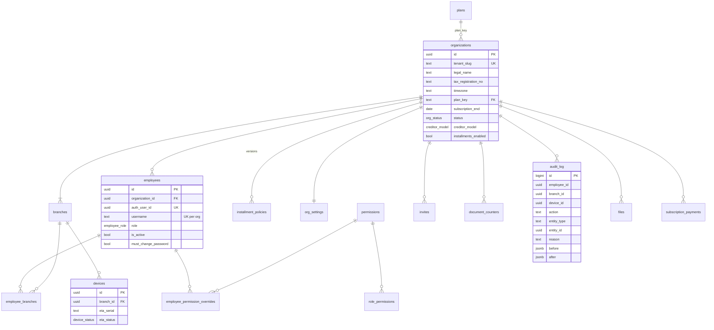
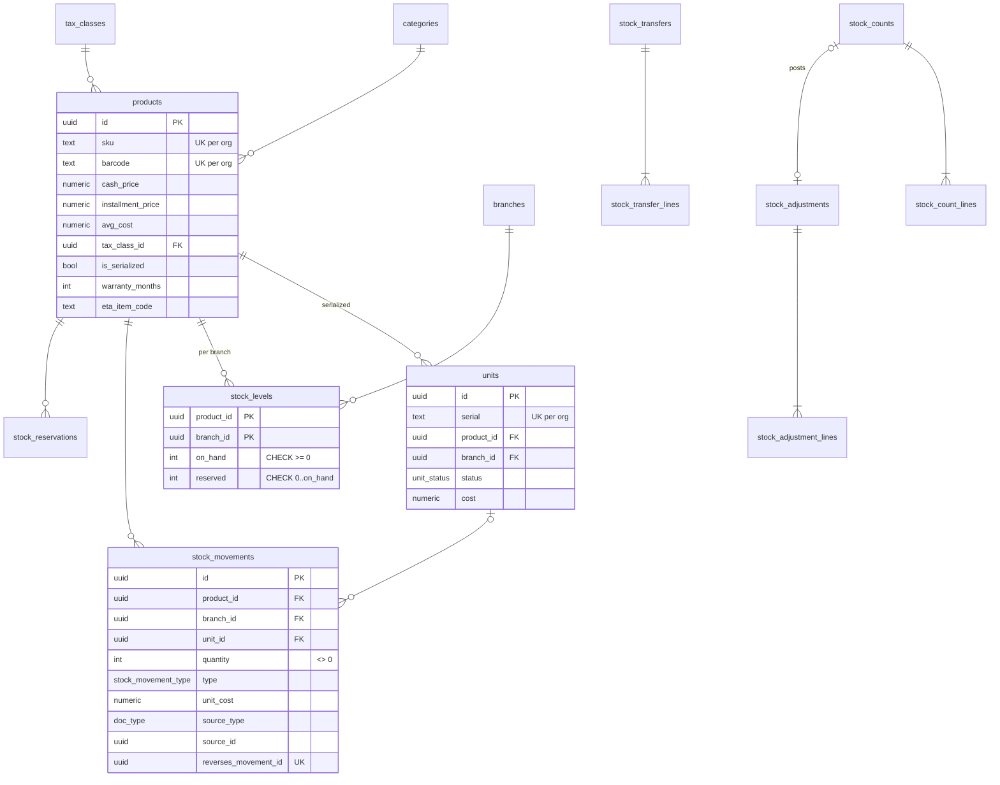
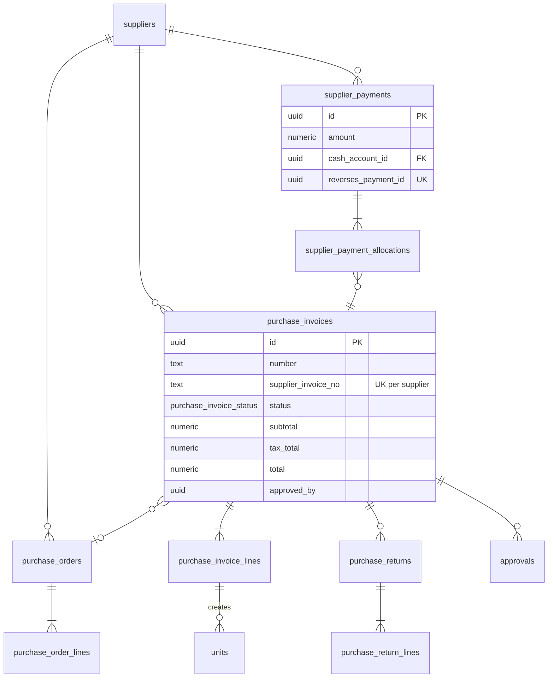
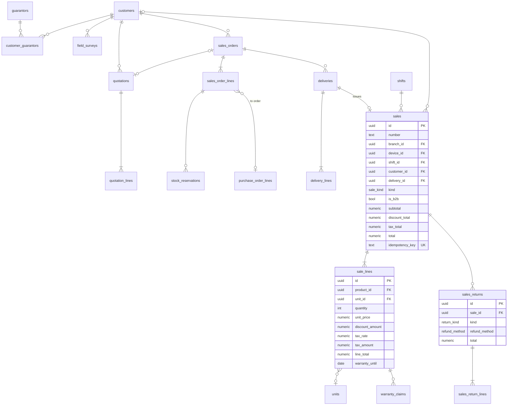
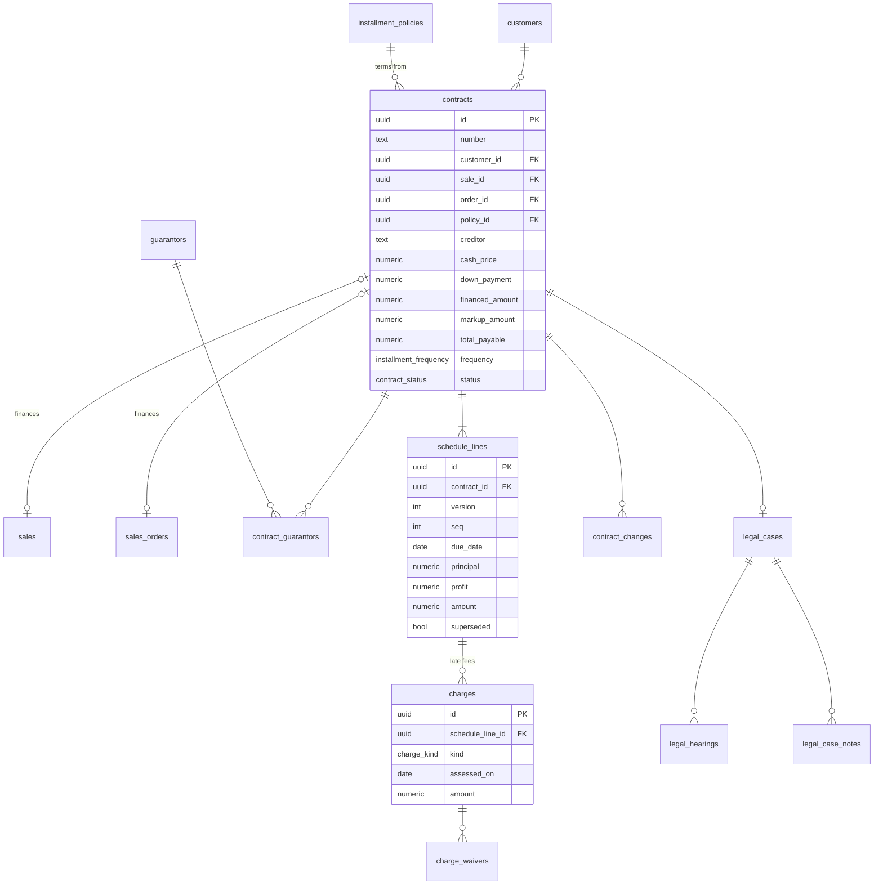
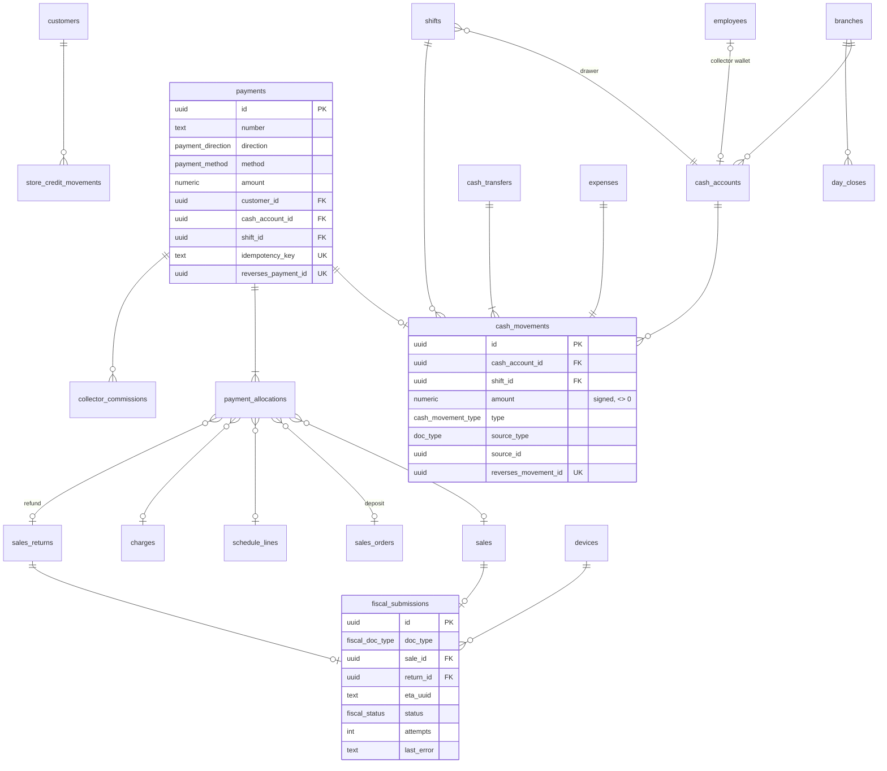

# EcoTech Pro: Physical Data Model (V1 baseline)

*Draft 1, 2 Oct 2026. This is the spec for the new baseline migration. It replaces `docs/db/initialization-v2.1.sql`. Based on the slices doc, the entity diagram, the repo audit and the team's decisions. Works on either runtime (Node or Workers).*

**Decisions applied:**
- Money is `numeric(18,2)`.
- Migrations are plain SQL through the Supabase CLI.
- Roles follow the spec list.
- Sales are separate documents.
- V2 tables (HR, partners, notifications) are left out.
- Owners join through an emailed invite.

---

## 1. Conventions (every table follows these)

| Rule | Detail |
|---|---|
| **Keys** | `id uuid PK default gen_random_uuid()`. Every tenant table also has `UNIQUE (id, organization_id)`. |
| **Tenant** | Every tenant table has `organization_id uuid NOT NULL`. Every foreign key to a tenant table is **composite**: `(x_id, organization_id) REFERENCES x(id, organization_id)`. This makes cross-shop links impossible at the DB level. |
| **Who and when** | `created_at timestamptz NOT NULL default now()` and `created_by uuid` (employee) on every table. Master data (products, customers, …) also has `updated_at`, `updated_by` and `archived_at`. Nothing is hard-deleted. |
| **Money** | `numeric(18,2)` with `CHECK (>= 0)` unless the column is a signed ledger amount. Average cost uses `numeric(18,4)`. TypeScript uses a decimal library, never `number`, for money. |
| **Quantities** | `integer`. Ledger quantities are signed and `<> 0`. |
| **Status fields** | Real Postgres `ENUM` types (listed in §9). |
| **Delete rules** | `ON DELETE RESTRICT` everywhere. No `CASCADE` on any money, stock or document table. |
| **Ledgers** | `stock_movements`, `cash_movements`, `store_credit_movements`, `audit_log`, `payments`, `payment_allocations` are **append-only**: a trigger raises on UPDATE and DELETE. |
| **Documents** | Every issued document has `number` (from `document_counters`) and `idempotency_key` with `UNIQUE (organization_id, idempotency_key)`. Corrections are new linked documents, never edits. |
| **Reversals** | Ledger rows have `reverses_<x>_id`, with a partial UNIQUE so a row can only be reversed once. |
| **Indexes** | Every tenant table gets an index starting with `organization_id`, plus an index on every FK column. |
| **Time** | `timestamptz` everywhere. Business dates (due dates, business days) use `date` in the shop's timezone (`organizations.timezone`). |

## 2. Access model (fixes the 3 critical audit findings)

1. **No direct table writes from outside.** `anon` and `authenticated` get **no** INSERT/UPDATE/DELETE on any table.
2. **Reads:** `authenticated` gets SELECT through RLS policies scoped by organization, and by branch where the slice requires it. PII columns (`national_id`, salary) aren't granted at all; they're read through a function that checks `customer.view_pii`. `anon` gets nothing.
3. **Writes go through database functions** (§10):
   - `SECURITY DEFINER` with `SET search_path = ''`.
   - Called with the **user's** JWT.
   - Each function derives the organization, employee and branch from `auth.uid()`, never from parameters.
   - Each one checks the permission key (`require_permission('sale.create')`), then does the whole write in one transaction with row locks.
4. **Result:** the API is a thin, typed layer. Even if someone calls Supabase directly with a stolen token, they can only do what that employee is allowed to do through the API.
5. **The service role** is used only for platform jobs (provisioning, scheduled jobs, ETA submission). Each of those calls is explicit and audited.
6. **Views** use `security_invoker = true`.

---

## 3. Platform and access

| Table | Columns (beyond the conventions) | Notes |
|---|---|---|
| `plans` *(platform)* | `key` PK, `name`, `price_monthly numeric(18,2)`, `max_branches`, `max_users`, `max_devices`, `modules text[]` | RLS on; SELECT for authenticated, writes by service role only |
| `organizations` | `name`, `legal_name`, `commercial_register`, `tax_registration_no`, `tenant_slug` UK, `timezone` (default `Africa/Cairo`), `default_language`, `logo_file_id`, `plan_key` FK, `subscription_start`, `subscription_end`, `status org_status`, `creditor_model`, `installments_enabled` | No UPDATE policy for tenants; changes go through functions (P03, P04) or the platform |
| `org_settings` | `organization_id` PK, `receipt_header`, `receipt_footer`, `receipt_width`, `prices_include_vat`, `default_tax_class_id`, `discount_caps jsonb` (role → %), `return_policy_days`, `purchase_approval_threshold`, `credit_limit_income_multiple` | P03 |
| `installment_policies` | `version int`, `min_down_payment_pct numeric(5,2)`, `max_months`, `markup_tiers jsonb`, `allowed_frequencies installment_frequency[]`, `min_installment`, `late_fee_type`, `late_fee_value`, `late_fee_cap`, `grace_days`, `early_settlement_rule`, `guarantor_required_above`, `survey_required_above`, `effective_from` | **Immutable versions.** A contract stores the `policy_id` it used. UNIQUE (org, version). |
| `branches` | `code` (UK per org), `name`, `address`, `phone`, `eta_branch_code`, `is_active` | |
| `employees` | `auth_user_id` UK, `full_name`, `phone`, `email`, `username` (UK per org, lower-cased), `national_id` (PII), `role employee_role`, `is_active`, `must_change_password`, `last_login_at` | One OWNER per org (partial UK) |
| `employee_branches` | `employee_id`, `branch_id` (PK both) | Branch scope |
| `permissions` *(platform)* | `key` PK, `description` | Seeded from the shared contracts list |
| `role_permissions` *(platform)* | `role`, `permission_key` (PK both) | Default permissions per role |
| `employee_permission_overrides` | `employee_id`, `permission_key`, `granted bool` | Add (`true`) or remove (`false`) a permission for one employee |
| `devices` | `branch_id`, `name`, `eta_serial`, `eta_status`, `is_active` | POS terminals (ETA, shifts, offline) |
| `invites` | `email`, `role`, `token_hash`, `expires_at NOT NULL`, `accepted_at`, `invited_by` | P01, O02. Only the hash of the token is stored. |
| `super_admins` *(platform)* | `auth_user_id` PK | |
| `audit_log` | `id bigint` identity, `employee_id`, `branch_id`, `device_id`, `ip inet`, `action`, `entity_type`, `entity_id`, `reason`, `before jsonb`, `after jsonb` | Append-only; written inside each write function |
| `document_counters` | `branch_id`, `doc_type`, `next_value bigint` (PK org+branch+doc_type) | Locked `FOR UPDATE` by `next_document_number()` |
| `files` | `bucket`, `path` (starts with org id), `mime`, `size_bytes`, `entity_type`, `entity_id` | F14, private bucket |
| `subscription_payments` | `amount`, `period_start`, `period_end`, `paid_at`, `recorded_by` | P05, manual |
| `eta_credentials` | `organization_id`, `environment`, `client_id`, `secret_ref` | The secret lives in **Supabase Vault**; only the reference is stored here |

---

## 4. Catalog and inventory

| Table | Columns | Notes |
|---|---|---|
| `tax_classes` | `name`, `kind tax_kind` (standard/zero/exempt), `rate numeric(5,2)`, `eta_tax_type`, `eta_subtype` | T01 |
| `categories` | `name` (UK per org), `parent_id` | C01 |
| `products` | `name_ar`, `name_en`, `sku` UK, `barcode` UK, `category_id`, `unit_of_measure`, `cash_price`, `installment_price`, `avg_cost numeric(18,4)`, `tax_class_id`, `warranty_months`, `is_serialized`, `min_stock`, `image_file_id`, `eta_item_code`, `eta_item_type` | `avg_cost` is set only by purchase approval. **ETA needs an item code (EGS/GS1) per product.** |
| `units` | `product_id`, `serial` (UK per org), `branch_id` (current), `status unit_status`, `cost`, `purchase_invoice_line_id` | I04. Status changes only inside write functions. |
| `stock_levels` | PK (`product_id`, `branch_id`), `on_hand`, `reserved` | **Changed only by the trigger on `stock_movements` / `stock_reservations`**, under a row lock. No direct writes. |
| `stock_movements` | `product_id`, `branch_id`, `unit_id`, `quantity` (signed, `<> 0`), `type`, `unit_cost`, `source_type`, `source_id`, `source_line_id`, `reverses_movement_id` | Append-only. The AFTER INSERT trigger updates `stock_levels`; `CHECK on_hand >= 0` stops overselling. |
| `stock_reservations` | `product_id`, `branch_id`, `unit_id`, `order_line_id`, `quantity`, `status reservation_status` | S10. The trigger keeps `stock_levels.reserved` in sync. |
| `stock_transfers` | `number`, `from_branch_id`, `to_branch_id`, `status transfer_status`, `sent_at/by`, `received_at/by`, `idempotency_key` | I03. In transit = sent minus received. |
| `stock_transfer_lines` | `transfer_id`, `product_id`, `unit_id`, `qty_sent`, `qty_received`, `discrepancy_reason` | |
| `stock_counts` | `number`, `branch_id`, `category_id`, `status count_status`, `posted_at/by` | I02 |
| `stock_count_lines` | `count_id`, `product_id`, `unit_id`, `expected_qty`, `counted_qty` | |
| `stock_adjustments` | `number`, `branch_id`, `reason adjustment_reason`, `note`, `count_id`, `idempotency_key` | I02 |
| `stock_adjustment_lines` | `adjustment_id`, `product_id`, `unit_id`, `quantity` (signed) | |

---

## 5. Purchasing

| Table | Columns | Notes |
|---|---|---|
| `suppliers` | `name`, `phone`, `tax_registration_no`, `address`, `payment_terms_days`, `archived_at` | U01. Balance comes from a view. |
| `purchase_orders` | `number`, `supplier_id`, `branch_id`, `status po_status`, `expected_date`, `notes`, `idempotency_key` | U05 |
| `purchase_order_lines` | `po_id`, `product_id`, `quantity`, `expected_unit_cost` | Received qty comes from a view over invoice lines |
| `purchase_invoices` | `number`, `supplier_invoice_no` (UK per org+supplier), `supplier_id`, `branch_id`, `po_id`, `invoice_date`, `status`, `subtotal`, `tax_total`, `total`, `approved_by/at`, `rejected_reason`, `idempotency_key` | U02. Approval posts stock and cost once; amount paid comes from a view. |
| `purchase_invoice_lines` | `invoice_id`, `product_id`, `po_line_id`, `quantity CHECK > 0`, `unit_cost`, `tax_class_id`, `tax_amount`, `line_total` | |
| `supplier_payments` | `number`, `supplier_id`, `cash_account_id`, `amount > 0`, `paid_at`, `idempotency_key`, `reverses_payment_id` | U03. Append-only. |
| `supplier_payment_allocations` | `supplier_payment_id`, `purchase_invoice_id`, `amount > 0` | The function blocks paying more than is outstanding |
| `purchase_returns` | `number`, `purchase_invoice_id`, `supplier_id`, `branch_id`, `refund_mode` (credit/cash), `cash_account_id`, `total`, `reason`, `idempotency_key` | U04 |
| `purchase_return_lines` | `return_id`, `invoice_line_id`, `product_id`, `unit_id`, `quantity > 0`, `unit_cost` | Quantity can't exceed what was bought minus what's already returned |
| `approvals` | `entity_type`, `entity_id`, `kind approval_kind`, `status approval_status`, `requested_by`, `decided_by/at`, `reason` | U06, plus price override, credit exception and over-cap discount |

---

## 6. Customers and sales

| Table | Columns | Notes |
|---|---|---|
| `customers` | `full_name`, `phones text[]`, `national_id` (PII, UK per org), `birth_date`, `gender`, `address`, `job`, `monthly_income`, `credit_limit`, `status customer_status`, `is_business`, `tax_registration_no`, `notes`, `archived_at` | R01, R03. Exposure comes from a view. |
| `guarantors` | `full_name`, `phone`, `national_id` (PII, UK per org), `address`, `job`, `customer_id` (nullable: set if the guarantor is also a customer) | R04. **Open point:** one shared person table vs this link (see §11). |
| `customer_guarantors` | `customer_id`, `guarantor_id`, `relation` | |
| `field_surveys` | `customer_id`, `assigned_to`, `status survey_status`, `scores jsonb`, `notes`, `lat`, `lng`, `gps_accuracy`, `submitted_at`, `decided_by/at` | R05. Photos live in `files`. |
| `quotations` / `quotation_lines` | `number`, `customer_id`, `branch_id`, `status`, `valid_until`, totals / `product_id`, `custom_notes`, `quantity`, `unit_price`, `discount_amount` | S09. No stock or money effect. |
| `sales_orders` | `number`, `customer_id`, `branch_id`, `quotation_id`, `status order_status`, totals, `idempotency_key` | S10. Deposits are `payment_allocations` that point to the order. |
| `sales_order_lines` | `order_id`, `product_id`, `custom_notes`, `quantity`, `unit_price`, `discount_amount`, `fulfilment` (from_stock/to_order), `po_line_id` | Delivered qty comes from a view over `delivery_lines` |
| `deliveries` | `number`, `order_id`, `branch_id`, `scheduled_date`, `time_window`, `address`, `driver_employee_id`, `status delivery_status`, `failed_reason`, `proof_file_id`, `delivered_at` | S11. Delivering **issues a `sales` row** for the delivered lines. |
| `delivery_lines` | `delivery_id`, `order_line_id`, `quantity`, `unit_id` | |
| `sales` | `number`, `branch_id`, `device_id`, `shift_id`, `customer_id`, `order_id`, `delivery_id`, `kind sale_kind` (pos/delivery), `is_b2b`, `subtotal`, `discount_total`, `tax_total`, `total`, `issued_at`, `idempotency_key` | S01. **Never updated.** A void is a `sales_returns` row with kind `void`. |
| `sale_lines` | `sale_id`, `line_no`, `product_id`, `unit_id`, `order_line_id`, `quantity > 0`, `unit_price`, `discount_amount`, `tax_class_id`, `tax_rate`, `tax_amount`, `line_total`, `warranty_until`, `price_override_approval_id` | The tax is a snapshot stored on the line. Warranty comes from `warranty_until`, so no separate warranty table is needed. |
| `sales_returns` | `number`, `sale_id`, `branch_id`, `shift_id`, `kind return_kind` (return/void/exchange), `refund_method`, `total`, `reason`, `exchange_sale_id`, `idempotency_key` | S05, S07 |
| `sales_return_lines` | `return_id`, `sale_line_id`, `unit_id`, `quantity > 0`, `condition` (resellable/damaged), `refund_amount`, `tax_amount` | The returned unit must match the sold unit |
| `warranty_claims` | `number`, `sale_line_id`, `unit_id`, `customer_id`, `issue`, `status claim_status`, `replacement_unit_id`, `resolution` | S12 |

---

## 7. Installments and legal

| Table | Columns | Notes |
|---|---|---|
| `contracts` | `number`, `customer_id`, `branch_id`, `sale_id` **or** `order_id` (CHECK exactly one), `policy_id`, `creditor` (snapshot from org), `cash_price`, `down_payment`, `financed_amount`, `markup_amount`, `total_payable`, `installments_count`, `frequency`, `first_due_date`, `status contract_status`, `is_migrated`, `migration_batch_id`, `idempotency_key` | N02. Terms never change after issue; only `status` moves. `CHECK total_payable = financed_amount + markup_amount`. |
| `contract_guarantors` | `contract_id`, `guarantor_id` | |
| `schedule_lines` | `contract_id`, `version`, `seq`, `due_date`, `principal`, `profit`, `amount = principal + profit`, `superseded` | UNIQUE (`contract_id`, `version`, `seq`). Rescheduling adds a new version and marks the old lines superseded. Paid and overdue status come from a view. |
| `charges` | `contract_id`, `schedule_line_id`, `kind charge_kind` (late_fee), `assessed_on date`, `amount` | N04. UNIQUE (`schedule_line_id`, `kind`, `assessed_on`), so a job run twice can't double a fee. |
| `charge_waivers` | `charge_id`, `amount`, `reason`, `approved_by` | |
| `contract_changes` | `contract_id`, `kind change_kind` (early_settlement/reschedule/write_off/return_adjustment), `old_version`, `new_version`, `amount`, `reason`, `approved_by` | N05 |
| `legal_cases` | `number`, `contract_id`, `case_number`, `court`, `lawyer_employee_id`, `case_type`, `status legal_status`, `next_hearing_date`, `opened_by` | L01 |
| `legal_hearings` | `case_id`, `hearing_date`, `outcome`, `notes` | |
| `legal_case_notes` | `case_id`, `note` | Documents live in `files` |

---

## 8. Money, payments, tax and operations

| Table | Columns | Notes |
|---|---|---|
| `cash_accounts` | `branch_id`, `name`, `kind cash_account_kind` (safe/bank/drawer/collector_wallet), `employee_id` (wallets), `is_active` | K01, N06 |
| `cash_movements` | `cash_account_id`, `shift_id`, `amount` (signed, `<> 0`), `type`, `source_type`, `source_id`, `reverses_movement_id` | Append-only. Balance = sum (view). A trigger blocks safes and drawers from going below 0. |
| `shifts` | `branch_id`, `device_id`, `employee_id`, `drawer_account_id`, `opening_float`, `opened_at`, `closed_at`, `counted_cash`, `count_breakdown jsonb`, `difference_reason`, `status shift_status` | K02. Partial UK: one open shift per employee and device. Expected cash = float + this shift's movements (view). |
| `payments` | `number`, `direction` (in/out), `method` (cash/bank_transfer/store_credit; card is V2), `amount > 0`, `customer_id`, `cash_account_id` (null for store credit), `shift_id`, `reference`, `received_by`, `idempotency_key`, `reverses_payment_id` | Append-only |
| `payment_allocations` | `payment_id`, `amount > 0`, and **exactly one** of `sale_id` / `order_id` / `schedule_line_id` / `charge_id` / `return_id` (CHECK) | N03 allocation order: fees, then oldest line (profit, then principal). A collection is never a new sale. |
| `store_credit_movements` | `customer_id`, `amount` (signed), `source_type`, `source_id` | Overpayments and store-credit refunds. Can't go below 0. |
| `cash_transfers` | `number`, `from_account_id`, `to_account_id`, `amount > 0`, `kind` (transfer/collector_settlement), `shortage_amount`, `reason`, `idempotency_key` | K01, N06. Both accounts in the same org (composite FK). |
| `expenses` | `number`, `branch_id`, `category`, `amount`, `cash_account_id`, `shift_id`, `note`, `receipt_file_id`, `reverses_expense_id` | K03 |
| `collector_commissions` | `employee_id`, `payment_id`, `amount`, `status` (accrued/paid), `paid_by_payment_id` | N06. Never mixed into cash. |
| `day_closes` | `branch_id`, `business_date`, `status`, `totals jsonb` (snapshot), `issues jsonb`, `closed_by/at` | K04. UK (org, branch, date). |
| `fiscal_submissions` | `branch_id`, `device_id`, `doc_type` (b2c_receipt/b2c_return/b2b_invoice/credit_note), `sale_id` or `return_id`, `eta_uuid`, `internal_id`, `status`, `attempts`, `last_error`, `payload jsonb`, `qr_payload`, `submitted_at`, `accepted_at` | T02–T04. UK per document, so a document is never submitted twice. |
| `import_jobs` | `kind`, `status`, `file_id`, `dry_run`, `report jsonb` | M01, M02 |

**Views** (all `security_invoker`): `v_stock_available`, `v_cash_balances`, `v_shift_expected_cash`, `v_supplier_balances`, `v_purchase_invoice_balances`, `v_customer_exposure`, `v_schedule_line_status` (paid / partly paid / overdue), `v_contract_balances`, `v_receivables_aging`, `v_order_line_fulfilment`, `v_unit_history`.

---

## 9. Enum types

| Enum | Values |
|---|---|
| `employee_role` | OWNER, BRANCH_MANAGER, CASHIER, WAREHOUSE, COLLECTOR, ACCOUNTANT, LAWYER |
| `org_status` | active, suspended, expired, closed |
| `creditor_model` | in_house *(third_party added in V2)* |
| `unit_status` | in_stock, reserved, in_transit, sold, returned, in_repair, written_off |
| `stock_movement_type` | opening, purchase_in, purchase_return_out, sale_out, sale_return_in, transfer_out, transfer_in, adjustment, delivery_out, claim_out, claim_in |
| `doc_type` | sale, sales_return, quotation, sales_order, delivery, contract, payment, purchase_order, purchase_invoice, purchase_return, supplier_payment, transfer, stock_count, stock_adjustment, cash_transfer, expense, warranty_claim, legal_case |
| `cash_movement_type` | float_in, float_out, sale, refund, deposit, collection, supplier_payment, expense, transfer_in, transfer_out, settlement, adjustment, opening |
| `payment_method` | cash, bank_transfer, store_credit |
| `installment_frequency` | monthly, weekly |
| `contract_status` | active, completed, rescheduled, written_off, returned |
| `legal_status` | preparing, filed, in_court, judgment, closed |
| Other statuses | transfer, count, PO, purchase invoice, order, delivery, claim, survey, approval, shift, fiscal, reservation, return kind, refund method, charge kind, change kind: values as in the slices doc |

## 10. Write functions (one transaction each)

Each one derives the org and employee from `auth.uid()`, checks a permission, locks the rows it changes, writes the ledgers and the audit log, and takes an idempotency key.

| Area | Functions |
|---|---|
| Platform | `provision_organization` (service role), `accept_invite`, `update_org_settings`, `publish_installment_policy` |
| Inventory | `post_stock_adjustment`, `post_stock_count`, `send_transfer`, `receive_transfer` |
| Purchasing | `approve_purchase_invoice`, `reject_purchase_invoice`, `post_supplier_payment`, `post_purchase_return` |
| Cash | `open_shift`, `close_shift`, `post_cash_transfer`, `settle_collector_wallet`, `post_expense`, `close_day` |
| Sales | `create_sale` (POS, split payments), `create_sales_return` (return / void / exchange), `create_sales_order`, `record_order_deposit`, `cancel_sales_order`, `complete_delivery` (issues the sale) |
| Installments | `preview_installment_terms` (read-only), `create_installment_contract` (inside `create_sale` / `create_sales_order`), `record_collection`, `assess_late_fees` (job), `waive_charge`, `settle_contract_early`, `reschedule_contract`, `write_off_contract` |
| Tax | `enqueue_fiscal_submission` (inside sale/return), `record_fiscal_result` (service role, job) |
| Helpers | `next_document_number`, `require_permission`, `current_employee`, `write_audit` |

## 11. Open points

1. **Customer vs guarantor:** can the same person be a customer and a guarantor? This model links them with `guarantors.customer_id`. A shared `persons` table is the alternative.
2. **Furniture on installments:** does the contract start at order time (`contracts.order_id`) or at delivery? Both are supported; pick one for V1.
3. **Collector wallets:** one per collector (this model) or one per collector per day?
4. **Runtime** (partner deciding). This model works with either.
