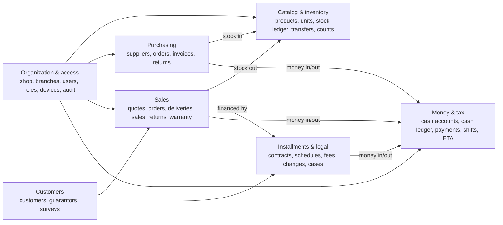
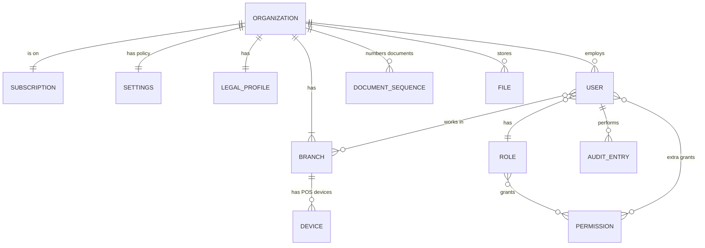
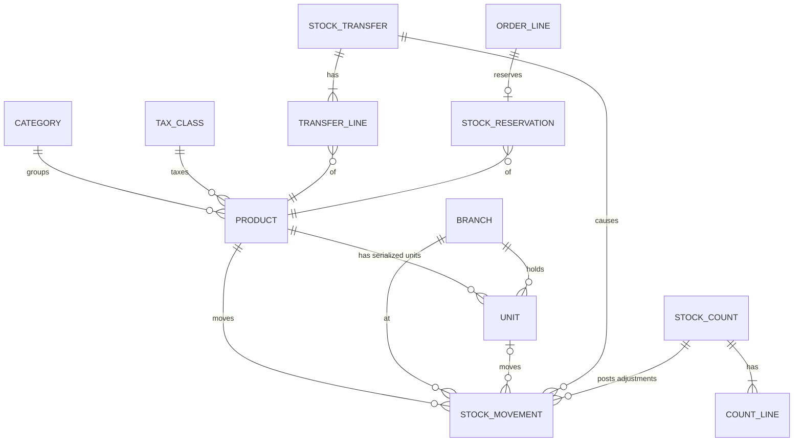
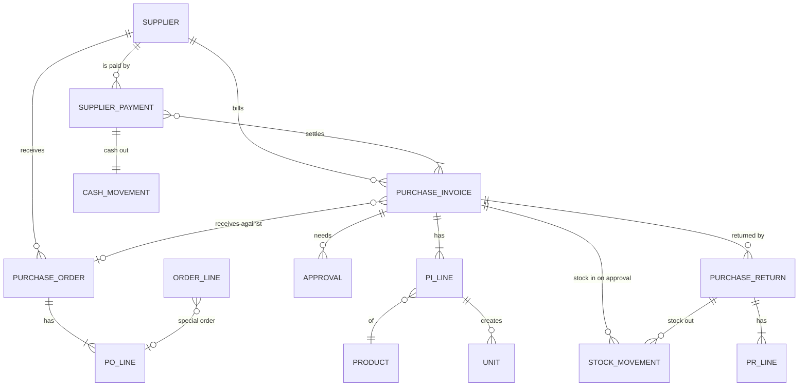
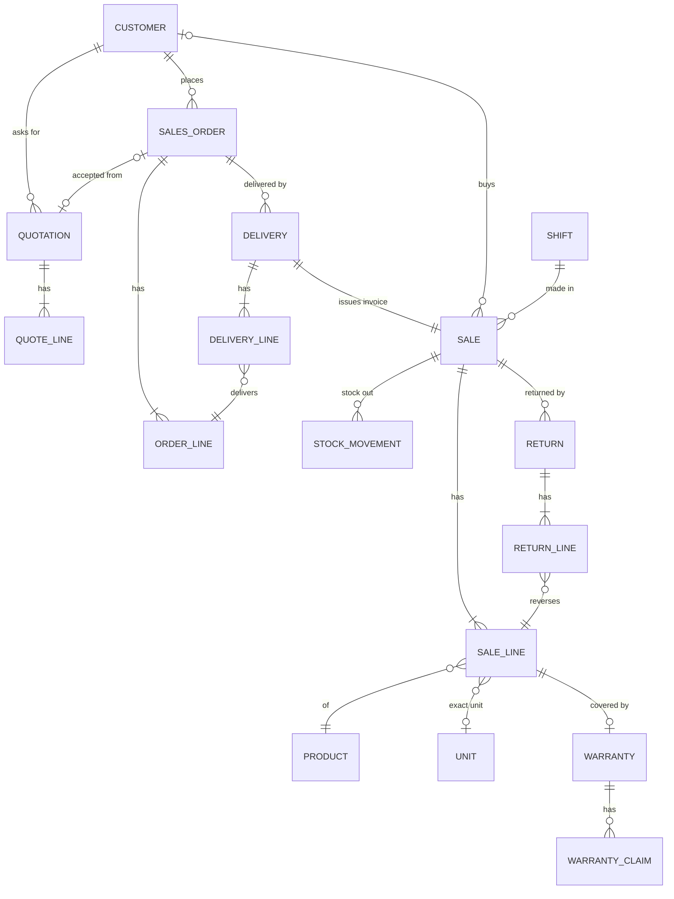
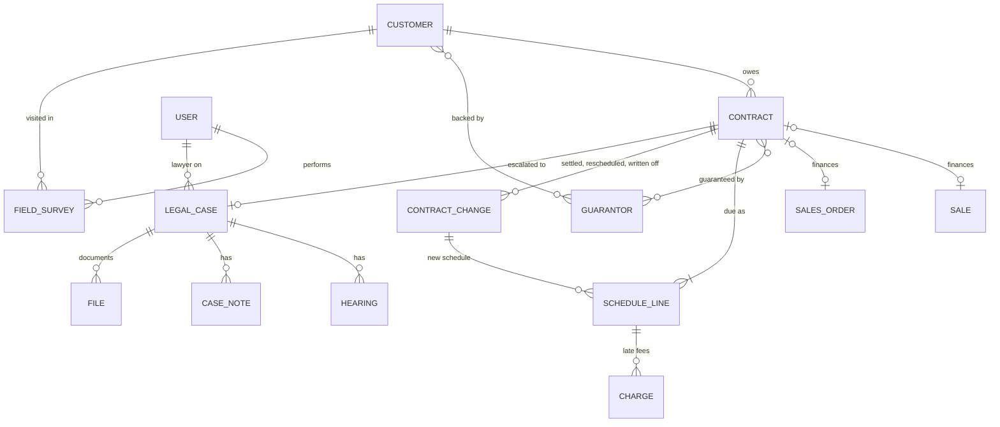
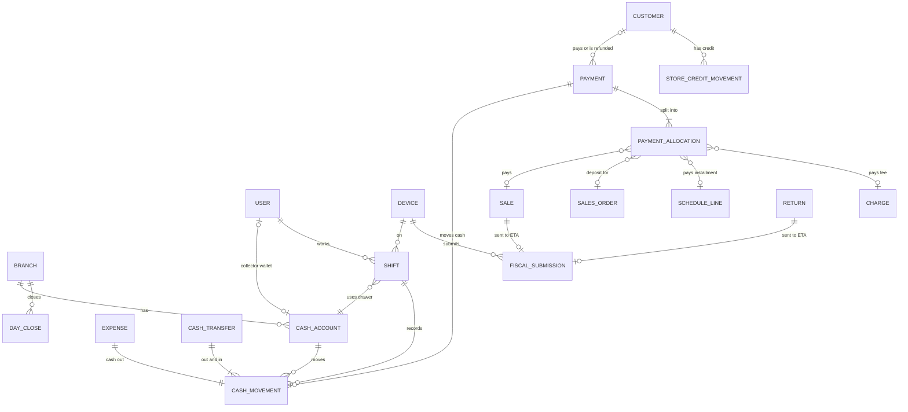

# EcoTech Pro: Entity Diagram (Conceptual, V1)

*Draft 1, 2 Oct 2026. Built from EcoTech_Pro_Slices.md. It shows the business objects and how they relate, not tables or columns: the physical ERD comes after the audit and will match the new repos.*

**How to read the lines:** `||` = exactly one, `o|` = zero or one, `|{` = one or more, `o{` = zero or more.

---

## Design decisions in this model

Each one fixes a problem from the old system.

1. **One stock ledger.** Every stock change is a `STOCK_MOVEMENT` pointing to the document that caused it. Stock on hand = sum of movements. (Fixes stock counted twice.)
2. **One cash ledger for every place money sits.** Safe, bank, cashier drawer and collector wallet are all a `CASH_ACCOUNT`, so all money moves as `CASH_MOVEMENT`. (Fixes collections credited twice, vault/wallet confusion.)
3. **Payments are separate from what they pay.** A `PAYMENT` splits into `PAYMENT_ALLOCATION`s, so one payment can cover a sale, a deposit, several installments or a late fee. Refunds are payments going out.
4. **A product is not a unit.** `PRODUCT` is the definition. `UNIT` is one physical serialized item (IMEI) with its own history and warranty.
5. **Selling now vs delivering later.** POS sells directly as a `SALE`. Furniture goes `QUOTATION → SALES_ORDER → DELIVERY`, and each delivery issues the `SALE` (invoice) for the delivered lines only.
6. **Documents are never edited.** A `RETURN` points to its `SALE`. A `CONTRACT_CHANGE` (settlement, reschedule, write-off) points to its `CONTRACT` and keeps the old schedule.
7. **Every receipt goes to the ETA once.** `SALE` and `RETURN` each have one `FISCAL_SUBMISSION`, sent from a registered `DEVICE`.

Every entity below belongs to one `ORGANIZATION` (shop). Those lines are left out of the diagrams to keep them readable.

---

## 0. Overview: how the areas connect

---

## 1. Organization & access

- `LEGAL_PROFILE` holds the legal seller and creditor model (in-house in V1).
- `DEVICE` is a registered POS terminal. The ETA needs it, and shifts and offline sales are tied to it.
- `SUPER_ADMIN` lives at platform level, outside any organization.

---

## 2. Catalog & inventory

- Only products with the "serialized" flag have `UNIT`s.
- Available stock = on hand (movements) − reserved (`STOCK_RESERVATION`).
- A transfer creates two movements: out of the source when sent, into the destination when received.

---

## 3. Purchasing

- `APPROVAL` is generic: it's used here for amount thresholds, and later for price overrides and credit exceptions.
- A special furniture order line (`ORDER_LINE`) can point to the purchase order line that brings it in.

---

## 4. Sales

- A walk-in cash sale has no customer (`CUSTOMER |o`).
- A POS sale has no order. An order's sale is created by its delivery.
- An exchange = a `RETURN` + a new `SALE`, linked.

---

## 5. Customers, installments & legal

- The credit limit and status are fields on `CUSTOMER`. Exposure is calculated from open contracts, not stored.
- A contract finances either a direct sale or a sales order. **Open point:** confirm furniture installments start at order time, not at delivery.
- Rescheduling never edits old schedule lines. It closes them and the `CONTRACT_CHANGE` creates new ones.

---

## 6. Money, payments & tax

- `CASH_ACCOUNT` types: safe, bank, drawer, collector wallet.
- Shift expected cash = opening float + that shift's `CASH_MOVEMENT`s, not the whole account balance.
- A payment by store credit moves `STORE_CREDIT_MOVEMENT` instead of cash. Overpayments land there too.
- A collection is a `PAYMENT` allocated to `SCHEDULE_LINE`s. It is not a new `SALE`, so there's no new revenue or VAT.

---

## Open points for you

1. **Furniture on installments:** does the contract start when the order is placed, or when the goods are delivered?
2. **Customers vs guarantors:** can the same person be a customer in one contract and a guarantor in another? If yes, they should share one `PERSON` record.
3. **Collector wallets:** one wallet per collector, or per collector per day?
